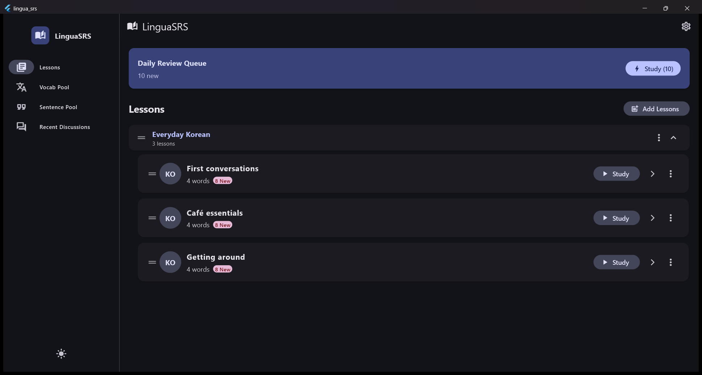
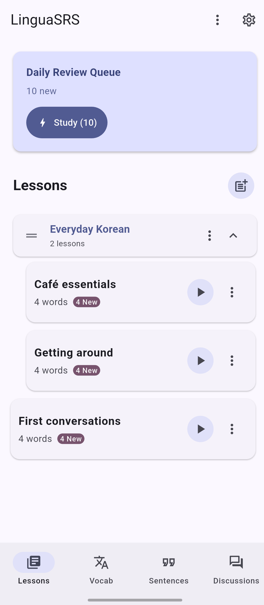
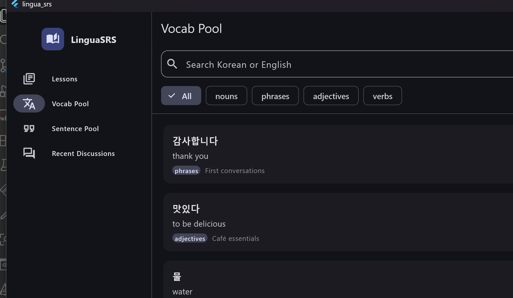
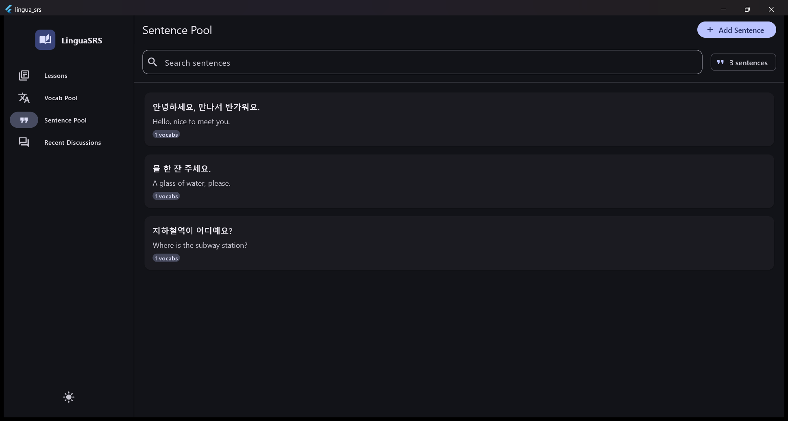

# LinguaSRS

SRS that puts language learning first: custom lessons, lesson-by-lesson vocabulary review, and a shared sentence pool. A Flutter app for **Windows, macOS, Linux, Android and iOS**, using an Anki-style SM-2 spaced repetition system.

## Screenshots

<table>
  <tr>
    <th align="center">Desktop</th>
    <th align="center">Android</th>
  </tr>
  <tr>
    <td valign="top"></td>
    <td valign="top"></td>
  </tr>
</table>

<details>
<summary>More desktop screenshots</summary>

<p align="center">
  
  
</p>
</details>

## Highlights

- **Lessons as Markdown + YAML** (see [lesson format](docs/lesson-format.md)):
  - Write lessons in-app, or import files, folders and ZIPs.
  - Group lessons into units and nested folders with `::`.
  - Read the full Markdown lesson in-app.
  - Re-importing updates in place and keeps your progress.
- **Smart cards**:
  - Verbs and adjectives are studied EN ➔ KO by default, other words KO ➔ EN; switch either direction (or both) on or off per word.
  - The front shows a random example sentence.
  - EN ➔ KO cards hide the word in that sentence (cloze deletion).
- **Shared pools**: browse, edit and link sentences across lessons; search every word in Korean or English.
- **Merge duplicates**: combine duplicate words into one shared card, by hand or with AI suggestions, with undo.
- **Audio**: stream-on-first-play with offline caching; offline system TTS on Android, cached online TTS elsewhere.
- **Pronunciation cues**: optional romanization (RR) and IPA lines for Korean words and sentences, shown on the back of the card.
- **Adaptive review**:
  - *Again* cards return a few cards later, interleaved with new cards. In addition, *Again* is due again after 1 hour and *Hard* after 12 hours.
  - Rolling 24-hour limits for reviews and new cards; the short *Again* and *Hard* repeats are never held back by them.
  - Review recent mistakes across lessons at any time.
  - Reset SRS progress for a lesson or a single word without changing card visibility.
- **Review controls**:
  - Flip cards and navigate back through answered cards.
  - Undo a rating.
  - Draw or type your answer before revealing it.
- **Study activity**: a one-year review heatmap, cards by stage, and a list of leeches (8+ lapses).
- **AI discussions**: ask DeepSeek (API key in Settings) about the current card or a whole lesson; chats are saved locally.
- **Backup and export**:
  - Back up and restore lessons and progress as JSON (the DeepSeek key is left out).
  - Export lessons or whole units as ZIP.
- **Keyboard-enabled**: Anki-style [hotkeys](docs/hotkeys.md), with undo.

Currently only Korean ➔ English is supported. Full details in [docs/features.md](docs/features.md).

## Running

```bash
flutter pub get
flutter run -d windows            # or macos, linux, <android/ios device id>
flutter test
```

## Docs

- [Features](docs/features.md)
- [Lesson format](docs/lesson-format.md)
- [Keyboard shortcuts](docs/hotkeys.md)
- [Architecture](docs/architecture.md)
- [Issues](https://github.com/patarapolw/lingua_srs/issues): bugs, ideas and planned work
- [AGENTS.md](AGENTS.md): conventions for contributors and coding agents
